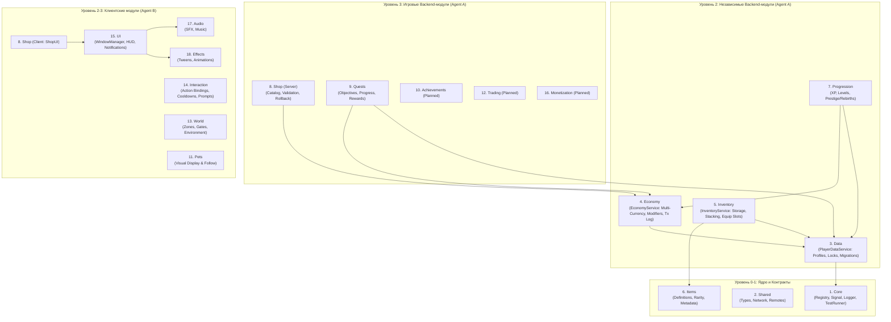

# 🏗️ ARCHITECTURE.md — Universal Reusable Roblox Framework

## 1. Видение и назначение фреймворка

**Universal Reusable Roblox Framework** — модульная библиотека и архитектурная платформа на языке Luau (`--!strict`), предназначенная для создания **любых** игр в Roblox (RPG, Tycoon, Simulator, Action, Obby, Social, Survival) без переписывания базовых систем.

### Главные архитектурные принципы:
1. **Независимость модулей (Zero Unnecessary Coupling):**
   - `Economy` работает без `Inventory`, `Items` и `World`.
   - `Inventory` работает без `Pets` и `Shop`.
   - `Data` работает с произвольной схемой данных через `RegisterSchemaSection`.
   - `UI` (`WindowManager`, `ShopUI`, `NotificationComponent`) не содержит серверной логики и работает через публичные сетевые контракты.
2. **Универсальное ядро + Опциональные адаптеры:**
   - Все игровые допущения (конкретные валюты, предметы, зоны, формулы престижа) вынесены в конфигурационные файлы (`Config.luau`) и подключаются через публичные адаптеры (`RegisterMultiplierModifier`, `RegisterSchemaSection`, `RegisterGrantHandler`).
3. **Серверная авторитетность (Server Authority):**
   - Балансы, транзакции, инвентарь, кулдауны и награды валидируются исключительно на сервере.

---

## 2. Карта 18 модулей фреймворка



---

## 3. Структура папок проекта (Rojo 7.7.1)

```text
roblox-coop-project/
├── default.project.json
├── ARCHITECTURE.md                # Архитектура 18 модулей
├── MODULE_REGISTRY.md             # Каталог и версии всех 18 модулей
├── API_REFERENCE.md               # Справочник публичных API
├── QUICK_START.md                 # Инструкция по быстрой установке в новую игру
├── MODULE_STANDARD.md             # Стандарт структуры модуля (init, Types, Config, README, tests)
├── INTEGRATION_GUIDE.md           # Паттерны интеграции и адаптеров без жёсткой связности
├── VERSIONING.md                  # Политика SemVer
├── CONTRIBUTING.md                # Git Workflow (feature/* -> PR -> develop -> main)
├── CHANGELOG.md                   # История версий
└── src/
    ├── shared/                    # -> ReplicatedStorage.Shared
    │   ├── Remotes.luau
    │   ├── Core/                  # Модули 1 (Core) и 2 (Shared) + README.md
    │   ├── Config/                # Конфигурации по умолчанию и модуль 6 (Items)
    │   └── Tests/                 # Тесты ядра и независимости модулей
    ├── server/                    # -> ServerScriptService.Server (Agent A)
    │   ├── init.server.luau
    │   └── Services/
    │       ├── PlayerDataService/ # Модуль 3 (Data): init, Types, Config, README, tests
    │       ├── EconomyService/    # Модуль 4 (Economy): init, Types, Config, README, tests
    │       ├── InventoryService/  # Модуль 5 (Inventory): init, Types, Config, README, tests
    │       ├── ProgressionService.luau # Модуль 7 (Progression)
    │       ├── ShopService.luau        # Модуль 8 (Shop Server)
    │       └── QuestService.luau       # Модуль 9 (Quests)
    └── client/                    # -> StarterPlayer.StarterPlayerScripts.Client (Agent B)
        ├── init.client.luau
        ├── Controllers/           # Модули 13 (World), 14 (Interaction), 15 (UI), 17 (Audio), 18 (Effects)
        ├── UI/                    # WindowManager, ShopUI/ (init, Types, Config, README, tests), Components/
        └── World/                 # Zones & Item/Pet Display (Модуль 11)
```
