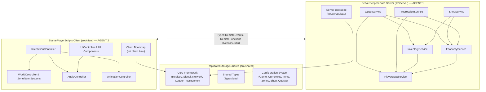

# 🏗️ ARCHITECTURE.md — Roblox Simulator Framework

## 1. Обзор и философия архитектуры

**Roblox Simulator Framework** — модульный, строго типизированный (`--!strict`) фреймворк на языке Luau, спроектированный для совместной параллельной разработки двумя AI-агентами (**Agent 1: `Breight321`** и **Agent 2: `anarugod`**) с использованием **Rojo 7.7.1** и **GitHub**.

Главные архитектурные принципы:
1. **Service-Controller-Shared Pattern:**
   - **Server Services (`src/server/Services/`)** — авторитетная бизнес-логика, хранение данных, валидация транзакций (Владелец: **Agent 1**).
   - **Client Controllers (`src/client/Controllers/`, `UI/`, `World/`)** — отображение UI, ввод игрока, визуальные зоны, эффекты, звук и анимации (Владелец: **Agent 2**).
   - **Shared Modules (`src/shared/`)** — ядро фреймворка (`Core`), конфигурационные таблицы (`Config`), общие типы (`Types.luau`) и сетевые контракты (`Network.luau`).
2. **Строгий граф зависимостей (DAG — Directed Acyclic Graph):**
   - Запрещены циклические зависимости (`A -> B -> A`).
   - Загрузчик модулей (`Registry.luau`) выполняет топологическую сортировку по полю `Dependencies` и выбрасывает ошибку на этапе `Init`, если обнаружен цикл.
3. **Единый источник истины (Single Source of Truth):**
   - Сервер является единственным источником истины для состояния игрока (валюта, инвентарь, прогрессия, квесты, покупки).
   - Клиент получает состояние через типизированные сетевые события (`Network.luau`) и отображает его реактивно.

---

## 2. Схема архитектуры и потоков данных



---

## 3. Описание 15 ключевых систем и границ ответственности

| № | Система | Расположение | Владелец | Зона ответственности |
|---|---------|--------------|----------|----------------------|
| 1 | **Core Framework** | `src/shared/Core/` | Agent 1 (Shared) | Базовые примитивы: `Logger`, `Result`, базовые утилиты жизненного цикла |
| 2 | **Module Loading** | `src/shared/Core/Registry.luau` | Agent 1 (Shared) | Регистрация сервисов/контроллеров, проверка DAG-зависимостей, `Init -> Start -> Shutdown` |
| 3 | **Event System** | `src/shared/Core/Signal.luau`, `Network.luau` | Agent 1 (Shared) | Внутренние сигналы (`Signal`) и межсетевой обмен (`Network` поверх `Remotes.luau`) |
| 4 | **Shared Modules & Types** | `src/shared/Core/Types.luau` | Shared (Agent 1 & 2) | Строгие контракты типов данных Luau для всех систем |
| 5 | **Configuration System** | `src/shared/Config/` | Shared (Agent 1 & 2) | Статические декларативные конфиги валют, предметов, зон, магазина и квестов |
| 6 | **Player Data** | `src/server/Services/PlayerDataService.luau` | **Agent 1** | Загрузка/сохранение профиля (`DataStoreService` с mock-режимом для Studio), `leaderstats`, сессии |
| 7 | **Economy** | `src/server/Services/EconomyService.luau` | **Agent 1** | Начисление/списание валют (`Coins`, `Gems`), расчёт множителей, анти-фрод валидация |
| 8 | **Inventory** | `src/server/Services/InventoryService.luau` | **Agent 1** | Хранение предметов/питомцев/инструментов, лимиты слотов, экипировка (`Equip`/`Unequip`) |
| 9 | **Progression** | `src/server/Services/ProgressionService.luau` | **Agent 1** | Уровни, опыт (`XP`), система перерождений (`Rebirths`), разблокировка зон (`UnlockedZones`) |
| 10 | **Gameplay Systems (Backend)** | `src/server/Services/ShopService.luau`, `QuestService.luau` | **Agent 1** | Серверная логика покупок в магазине, трекинг прогресса квестов и выдача наград |
| 11 | **Client Controllers** | `src/client/Controllers/` | **Agent 2** | Оркестрация клиентской логики, приём сетевых состояний с сервера |
| 12 | **UI Framework & Components** | `src/client/Controllers/UIController.luau`, `src/client/UI/` | **Agent 2** | Управление экранами (HUD, модальные окна магазина, инвентаря, ребиртов, уведомлений) |
| 13 | **Interaction System** | `src/client/Controllers/InteractionController.luau` | **Agent 2** | Обработка кликов/тапов симулятора, `ProximityPrompt`, триггеры зон и магазинов |
| 14 | **World & Zone System** | `src/client/Controllers/WorldController.luau`, `src/client/World/` | **Agent 2** | Клиентское отображение барьеров зон, спавн визуальных объектов и компонентов предметов |
| 15 | **Additional Features (Audio & Animation)** | `src/client/Controllers/AudioController.luau`, `AnimationController.luau` | **Agent 2** | Звуковые эффекты (SFX/BGM), твины и анимации персонажа/питомцев/интерфейса |

---

## 4. Структура папок проекта (Rojo Mapping)

```text
roblox-coop-project/
├── default.project.json           # Конфигурация Rojo 7.7.1
├── ARCHITECTURE.md                # Архитектура фреймворка
├── API_REGISTRY.md                # Единый реестр публичных API, типов и сетевых событий
├── MODULE_STANDARD.md             # Стандарт написания модулей Luau
├── CONTRIBUTING.md                # Правила Git-процесса, PR и ревью
├── TASKS.md                       # Распределение задач между Agent 1 и Agent 2
├── CHANGELOG.md                   # История архитектурных и кодовых изменений
├── AGENTS.md                      # Протокол синхронизации двух агентов
├── AGENT_SYNC.md                  # Оперативная доска статуса агентов
└── src/
    ├── shared/                    # -> ReplicatedStorage.Shared
    │   ├── Remotes.luau           # Базовый хелпер RemoteEvent (сохранён для совместимости)
    │   ├── Core/
    │   │   ├── Types.luau         # Все общие типы Luau (--!strict)
    │   │   ├── Logger.luau        # Структурированное логирование
    │   │   ├── Signal.luau        # Событийная шина (Observer/Signal)
    │   │   ├── Network.luau       # Типизированный сетевой слой (Events & Functions)
    │   │   ├── Registry.luau      # Загрузчик модулей и менеджер жизненного цикла
    │   │   └── TestRunner.luau    # Встроенный фреймворк модульного тестирования
    │   ├── Config/
    │   │   ├── GameConfig.luau
    │   │   ├── CurrenciesConfig.luau
    │   │   ├── ItemsConfig.luau
    │   │   ├── ZonesConfig.luau
    │   │   ├── ShopConfig.luau
    │   │   └── QuestsConfig.luau
    │   └── Tests/
    │       └── FrameworkTests.luau
    ├── server/                    # -> ServerScriptService.Server (AGENT 1)
    │   ├── init.server.luau       # Серверный Bootstrap
    │   └── Services/
    │       ├── PlayerDataService.luau
    │       ├── EconomyService.luau
    │       ├── InventoryService.luau
    │       ├── ProgressionService.luau
    │       ├── ShopService.luau
    │       └── QuestService.luau
    └── client/                    # -> StarterPlayer.StarterPlayerScripts.Client (AGENT 2)
        ├── init.client.luau       # Клиентский Bootstrap
        ├── Controllers/           # Контроллеры клиента (Agent 2)
        ├── UI/                    # UI Framework & Components (Agent 2)
        │   └── Components/
        └── World/                 # World, Zones & Item Components (Agent 2)
            ├── Zones/
            └── Items/
```

---

## 5. Правила предотвращения циклических зависимостей

1. **Иерархия слоёв (снизу вверх):**
   - **Уровень 0:** `Types.luau`, `Config/*` (не зависят ни от каких модулей).
   - **Уровень 1:** `Logger.luau`, `Signal.luau`, `Remotes.luau`, `Network.luau` (зависят только от Уровня 0).
   - **Уровень 2:** `Registry.luau`, `TestRunner.luau` (зависят от Уровня 0–1).
   - **Уровень 3 (Базовые сервисы):** `PlayerDataService` (не зависит от других игровых сервисов).
   - **Уровень 4 (Доменные сервисы):** `EconomyService`, `InventoryService` (зависят только от `PlayerDataService`).
   - **Уровень 5 (Композитные сервисы):** `ProgressionService`, `ShopService`, `QuestService` (зависят от `PlayerDataService`, `EconomyService`, `InventoryService`).
2. **Запрет прямого `require` между сервисами одного уровня:**
   - Сервисы получают ссылки на зависимости через `Registry:GetService(name)` внутри `Init(registry)` и обязаны объявлять их в массиве `Dependencies = { ... }`.
   - Клиентские модули (`src/client/`) **никогда** не импортируют `src/server/`, и наоборот.
