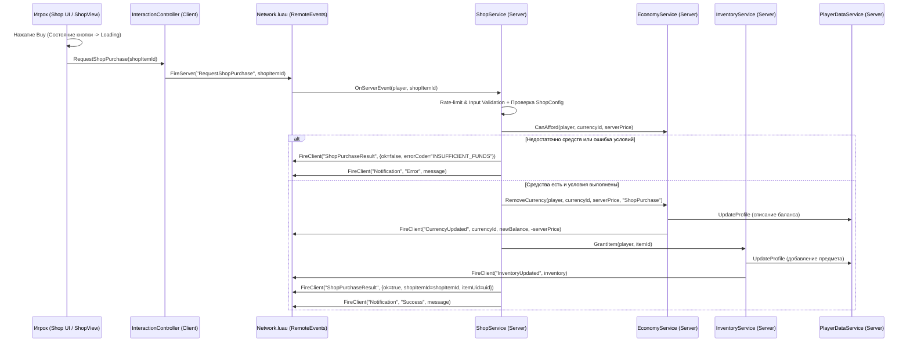

# 🏗️ docs/ARCHITECTURE.md — Архитектура Roblox Simulator Framework

## 1. Назначение и принципы фреймворка

**Roblox Simulator Framework** — переиспользуемая модульная платформа на Luau (`--!strict`) для создания игр жанра Simulator в Roblox. Архитектура спроектирована так, чтобы **Agent A (`Breight321` — Backend)** и **Agent B (`anarugod` — Client/UI)** могли разрабатывать, тестировать и подключать модули независимо без переписывания чужого кода.

### Ключевые инварианты архитектуры:
1. **Сервер — единственный источник истины (Server Authority):**
   - Баланс валют, состояние инвентаря, цены товаров, лимиты, кулдауны и выдача наград рассчитываются и проверяются исключительно на сервере.
   - Клиент отправляет только **намерения** (`RequestShopPurchase`, `RequestActionClick`, `RequestEquipItem`) и отображает подтверждённое сервером состояние.
2. **Отсутствие циклических зависимостей (DAG Lifecycle):**
   - Загрузчик `src/shared/Core/Registry.luau` строит направленный ациклический граф (DAG) по списку `Dependencies` и инициализирует модули строго в топологическом порядке (`Init -> Start -> Shutdown`).
3. **Разделение слоёв (Rojo Mapping):**
   - `src/shared` $\rightarrow$ `ReplicatedStorage.Shared` (общие типы, конфигурация, ядро, сетевой транспорт).
   - `src/server` $\rightarrow$ `ServerScriptService.Server` (серверные сервисы и валидация — **Agent A**).
   - `src/client` $\rightarrow$ `StarterPlayer.StarterPlayerScripts.Client` (контроллеры, `WindowManager`, `Shop UI` и мир — **Agent B**).

---

## 2. Диаграмма взаимодействия (Economy Backend + Shop UI)

---

## 3. Слои системы и зоны ответственности

| Слой | Путь в репозитории | Владелец | Модули |
|---|---|---|---|
| **Core Framework** | `src/shared/Core/` | Agent A (Shared) | `Types.luau`, `Logger.luau`, `Signal.luau`, `Network.luau`, `Registry.luau`, `TestRunner.luau` |
| **Config System** | `src/shared/Config/` | Shared | `GameConfig`, `CurrenciesConfig`, `ItemsConfig`, `ZonesConfig`, `ShopConfig`, `QuestsConfig` |
| **Backend Services** | `src/server/Services/` | **Agent A (`Breight321`)** | `PlayerDataService`, `EconomyService/` (модульный пакет), `InventoryService`, `ProgressionService`, `ShopService`, `QuestService` |
| **Client Controllers** | `src/client/Controllers/` | **Agent B (`anarugod`)** | `UIController`, `InteractionController`, `WorldController`, `AudioController`, `AnimationController` |
| **UI & World** | `src/client/UI/`, `src/client/World/` | **Agent B (`anarugod`)** | `WindowManager`, `Theme`, `HUDComponent`, `ShopView`, `InventoryView`, `QuestsView`, `RebirthView`, `NotificationComponent`, `ZoneGateManager`, `ItemDisplayManager` |
