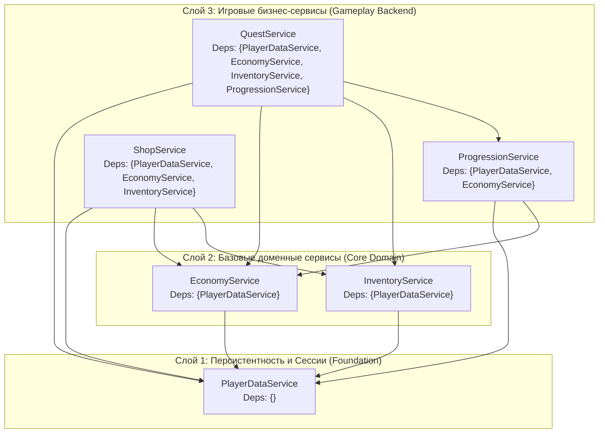

# 🏛️ BACKEND_ARCHITECTURE.md — Архитектура Server & Shared и Core Services

**Владелец:** Agent 1 (`Breight321`)  
**Статус:** Готово к согласованию и интеграции  
**Ветка:** `feature/agent1-backend-design`

---

## 1. Аудит и проверка структуры `src/server` и `src/shared`

Проведён полный аудит актуального состояния репозитория после слияния клиентской части от **Agent 2 (`anarugod`)** (PR #3 и PR #4 в `develop`).

### 1.1 Текущее дерево `src/shared` и `src/server`

```text
src/
├── shared/                              # ReplicatedStorage.Shared (Общий слой)
│   ├── Remotes.luau                     # Низкоуровневый фабричный модуль RemoteEvent
│   ├── Core/
│   │   ├── Types.luau                   # Строгие контракты типов данных (--!strict)
│   │   ├── Logger.luau                  # Структурированное логирование с уровнями
│   │   ├── Signal.luau                  # Типизированная внутрипроцессная шина событий
│   │   ├── Network.luau                 # Типизированный транспорт Server <-> Client
│   │   ├── Registry.luau                # DI-контейнер и загрузчик DAG-зависимостей
│   │   └── TestRunner.luau              # Модульный тестовый фреймворк
│   ├── Config/
│   │   ├── GameConfig.luau              # Глобальные константы симулятора и прогрессии
│   │   ├── CurrenciesConfig.luau        # Метаданные валют (Coins, Gems)
│   │   ├── ItemsConfig.luau             # База предметов, инструментов и питомцев
│   │   ├── ZonesConfig.luau             # База локаций и требований к открытию
│   │   ├── ShopConfig.luau              # Офферы магазина
│   │   └── QuestsConfig.luau            # Шаблоны квестов и наград
│   └── Tests/
│       └── FrameworkTests.luau          # Автотесты ядра и DAG-графа (Server + Client)
└── server/                              # ServerScriptService.Server (Только Agent 1)
    ├── init.server.luau                 # Серверный Bootstrap
    └── Services/
        ├── PlayerDataService.luau       # Уровень 1 (Core Data Layer)
        ├── EconomyService.luau          # Уровень 2 (Domain Layer)
        ├── InventoryService.luau        # Уровень 2 (Domain Layer)
        ├── ProgressionService.luau      # Уровень 3 (Gameplay Layer)
        ├── ShopService.luau             # Уровень 3 (Gameplay Layer)
        └── QuestService.luau            # Уровень 3 (Gameplay Layer)
```

### 1.2 Результаты проверки совместимости с `src/client` (Agent 2)
1. **Нулевое пересечение файлов:** Файлы Agent 2 строго изолированы в `src/client/` (`Controllers/`, `UI/`, `World/`).
2. **Соответствие сетевых событий:** Клиентские контроллеры Agent 2 (`UIController`, `InteractionController`, `WorldController`) и UI-компоненты (`ShopView`, `InventoryView`, `QuestsView`, `RebirthView`) используют исключительно события из `Network.Events`.
3. **Точка внимания при аудите:**
   - В `InteractionController:TriggerPrimaryAction()` клиент отправляет `Network.FireServer(Network.Events.RequestActionClick, equippedToolUid)`. Серверный `EconomyService` должен принимать необязательный `equippedToolUid: string?`, валидировать его принадлежность игроку на сервере (не доверяя клиенту в расчёте множителя) и уведомлять `QuestService` о прогрессе целей `"Clicks"` и `"EarnCoins"`.

---

## 2. Проектирование Core Services (Серверное ядро)

### 2.1 Слоистая архитектура и граф зависимостей (DAG)

Серверные сервисы разделены на **3 строго упорядоченных слоя** для исключения циклических зависимостей:



### 2.2 Топологический порядок инициализации (`Registry:InitAll()`)
При запуске сервера `Registry` гарантированно инициализирует и запускает сервисы в следующем детерминированном порядке:
1. `PlayerDataService` (0 зависимостей)
2. `EconomyService` (зависит от `PlayerDataService`)
3. `InventoryService` (зависит от `PlayerDataService`)
4. `ProgressionService` (зависит от `PlayerDataService`, `EconomyService`)
5. `QuestService` (зависит от `PlayerDataService`, `EconomyService`, `ProgressionService`)
6. `ShopService` (зависит от `PlayerDataService`, `EconomyService`, `InventoryService`)

При остановке сервера (`game:BindToClose` -> `Registry:ShutdownAll()`) метод `:Shutdown()` вызывается **в строго обратном порядке** (`ShopService` -> ... -> `PlayerDataService`), что гарантирует завершение всех игровых транзакций до финального сброса профилей в `DataStoreService`.

### 2.3 Принципы проектирования каждого Core Service

| Сервис | Роль в архитектуре | Ключевые инварианты безопасности |
|---|---|---|
| **`PlayerDataService`** | Владелец состояния в памяти (`profiles[player]`), менеджер сессионных локов и автосохранения | Ни один другой сервис не вызывает `DataStoreService` напрямую; мутации проходят только через атомарный `UpdateProfile(player, mutator)` |
| **`EconomyService`** | Единый расчётный центр валют (`Coins`, `Gems`) и множителей дохода | Запрещены отрицательные начисления, переполнение свыше `maxAmount` и списание в минус; проверка серверного кулдауна клика |
| **`InventoryService`** | Управление экземплярами предметов (`InventoryItem`) и слотами экипировки | Проверка `MaxInventorySlots`, `MaxEquippedPets`, уникальность `uid` через `HttpService:GenerateGUID(false)` |
| **`ProgressionService`** | Расчёт кривой опыта (`XP`/`Level`), проведение `Rebirth` и открытие зон | Проверка стоимости ребирта и требований по `requiredRebirths` для зон перед списанием валюты |
| **`ShopService`** | Координатор покупок между `EconomyService` и `InventoryService` | Двухфазная транзакция: списание валюты -> выдача предмета (с автоматическим откатом `Rollback` при ошибке инвентаря) |
| **`QuestService`** | Реактивный трекер целей (`Clicks`, `EarnCoins`, `Rebirths`, `UnlockZones`) и выдача наград | Защита от повторного получения награды (`claimed == true`), валидация `progress >= target` |
