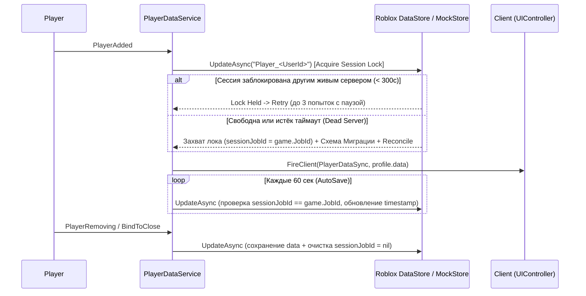

# 💾 PLAYER_DATA_PERSISTENCE_SPEC.md — Архитектура данных игрока и безопасного сохранения

**Владелец:** Agent 1 (`Breight321`)  
**Статус:** Архитектурная спецификация для реализации `PlayerDataService`  
**Ветка:** `feature/agent1-backend-design`

---

## 1. Player Data Architecture (Структура профиля игрока)

Данные игрока разделяются на **два уровня**:
1. **`PlayerProfileEnvelope` (Конверт хранения в DataStore):** содержит метаданные блокировки сессии (`meta`) и полезную нагрузку (`data`).
2. **`PlayerProfileData` (Игровой профиль):** чистая структура игровых данных, синхронизируемая с клиентом через `Network.Events.PlayerDataSync` (клиенту не передаются внутренние серверные токены блокировки).

### 1.1 Полная схема `PlayerProfileEnvelope` и `PlayerProfileData`

```luau
-- Внутренний конверт для DataStoreService (Только Server)
export type SessionMeta = {
	sessionJobId: string?,       -- game.JobId активного сервера, владеющего сессией
	sessionLockTimestamp: number,-- os.time() последнего обновления блокировки
	createdAt: number,           -- os.time() создания профиля
	updatedAt: number,           -- os.time() последнего сохранения
	saveCount: number,           -- Монотонно растущий счётчик сохранений
}

export type PlayerProfileEnvelope = {
	meta: SessionMeta,
	data: PlayerProfileData,
}

-- Игровой профиль (Shared контракт с Agent 2)
export type PlayerProfileData = {
	schemaVersion: number,                        -- Текущая версия схемы (v1)
	currencies: { [CurrencyId]: number },         -- { Coins = 0, Gems = 0 }
	rebirths: number,                             -- Количество перерождений
	level: number,                                -- Текущий уровень
	xp: number,                                   -- Текущий опыт
	unlockedZones: { [string]: boolean },         -- { spawn_meadow = true, ... }
	inventory: { [string]: InventoryItem },       -- Словарь uid -> InventoryItem
	quests: { [string]: QuestState },             -- Словарь questId -> QuestState
	stats: {
		totalClicks: number,
		totalCoinsEarned: number,
		playTimeSeconds: number,
	},
}
```

---

## 2. Безопасная система сохранения данных (Safe Persistence Architecture)

Для предотвращения потери прогресса, состояния гонки (race conditions) при телепортации между серверами и дюпа предметов/валюты проектируется **5-уровневая система защиты**:



### 2.1 Механизм Session Locking (Защита от дюпа)
1. При входе игрока `PlayerDataService` вызывает `DataStore:UpdateAsync(key, transformFn)`.
2. Внутри `transformFn`:
   - Проверяется `envelope.meta.sessionJobId`.
   - Если `sessionJobId ~= nil` и `sessionJobId ~= game.JobId`:
     - Вычисляется возраст блокировки: `os.time() - envelope.meta.sessionLockTimestamp`.
     - Если возраст `< SESSION_LOCK_TIMEOUT` (300 секунд / 5 минут), значит профиль ещё выгружается другим сервером — возвращаем `nil` (отмена записи) и делаем до 3 повторных попыток с интервалом 2 сек.
     - Если возраст `>= 300` секунд (предыдущий сервер упал без `BindToClose`), блокировка принудительно перехватывается текущим сервером.
3. При штатном выходе (`PlayerRemoving`) или завершении сервера (`Shutdown`) поле `meta.sessionJobId` сбрасывается в `nil`, мгновенно освобождая профиль для следующего сервера.

### 2.2 Система миграций схем (Schema Migrations & Template Reconciliation)
Чтобы обновления игры никогда не ломали старые сохранения игроков:
1. **Конвейер миграций (`Migrations`):**
   - Если `rawProfile.schemaVersion < GameConfig.DataSchemaVersion`, последовательно выполняются функции миграции `v -> v + 1`.
2. **Глубокая сверка с шаблоном (`ReconcileProfile`):**
   - Если в `CurrenciesConfig` или `QuestsConfig` добавлена новая валюта или квест, функция `reconcileTable(target, defaultTemplate)` автоматически дописывает недостающие поля, не перезаписывая существующий прогресс игрока.
3. **Санитизация значений (`SanitizeProfile`):**
   - Проверка `NaN` (`val ~= val`), отрицательных балансов и некорректных типов перед загрузкой в память.

### 2.3 Отказоустойчивость: Retry с Exponential Backoff + Studio Mock Fallback
1. **Exponential Backoff:** Все обращения к `DataStoreService` оборачиваются в `retryWithBackoff(maxAttempts = 3, baseDelay = 1.0)`:
   $$t_{\text{delay}} = \text{baseDelay} \cdot 2^{\text{attempt} - 1} + \text{jitter}(0, 0.25)$$
2. **Studio / Offline Fallback (`InMemoryDataStore`):**
   - Если игра запущена в локальном Roblox Studio без опубликованного плейса или без включённого переключателя *Enable Studio Access to API Services*, `PlayerDataService` автоматически перехватывает ошибку инициализации `DataStoreService` и прозрачно переключается на встроенное `InMemoryDataStore`, выводя предупреждение через `Logger:Warn`. Это позволяет обоим агентам тестировать весь игровой цикл без блокировок!

### 2.4 Фоновое автосохранение и `BindToClose`
- **Auto-Save Loop:** Фоновый `task.spawn` цикл проходит по активным игрокам каждые `GameConfig.AutoSaveIntervalSeconds` (60 сек), обновляя `sessionLockTimestamp` и сохраняя грязные (`dirty = true`) профили.
- **Флаг `dirty`:** Чтобы не расходовать лимиты `DataStoreService` впустую, `UpdateProfile` помечает профиль флагом `dirtyPorts[player] = true`, а автосохранение записывает в DataStore только изменённые профили (либо раз в 3 минуты для продления heartbeat лока).
- **Graceful Shutdown (`BindToClose`):** При остановке сервера все активные профили сохраняются **параллельно** через `task.spawn` с ожиданием завершения через счётчик корутин (`activeSaves == 0`), укладываясь в лимит Roblox.
