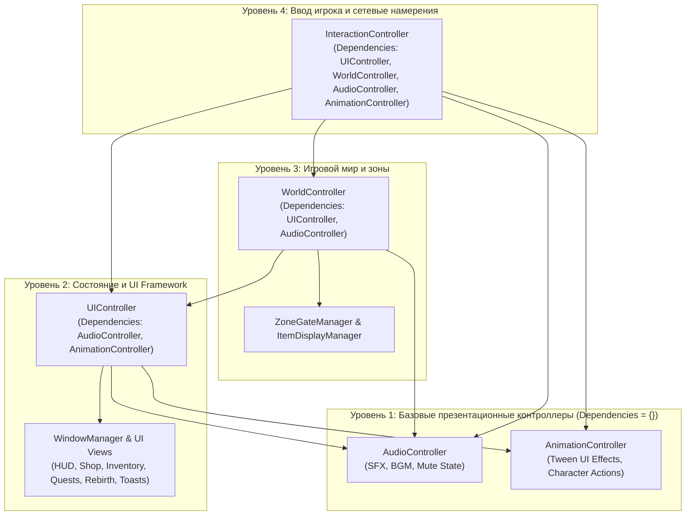
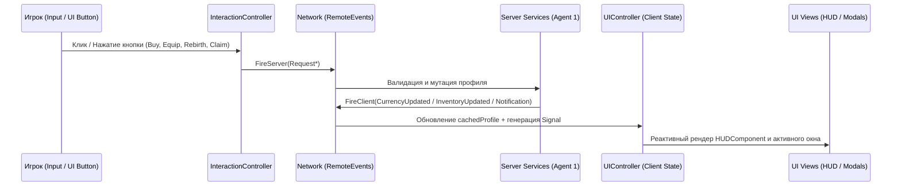

# 🎨 CLIENT_ARCHITECTURE.md — Архитектура Client & Shared, UI Framework и Window Manager

**Владелец:** Agent 2 (`anarugod`)  
**Статус:** Готово к согласованию и интеграции  
**Ветка:** `feature/agent2-client-design`

---

## 1. Аудит и проверка структуры `src/client` и `src/shared`

Проведён полный аудит клиентской и общей кодовой базы после синхронизации с `origin/develop` (включая серверную спецификацию от **Agent 1 (`Breight321`)** в `docs/backend/`).

### 1.1 Актуальное дерево `src/shared` и `src/client`

```text
src/
├── shared/                                  # ReplicatedStorage.Shared (Общий слой Agent 1 & Agent 2)
│   ├── Remotes.luau                         # Низкоуровневый менеджер RemoteEvent
│   ├── Core/
│   │   ├── Types.luau                       # Строгие контракты типов данных (--!strict)
│   │   ├── Logger.luau                      # Структурированное логирование
│   │   ├── Signal.luau                      # Типизированная внутрипроцессная шина событий
│   │   ├── Network.luau                     # Единый транспортный слой Server <-> Client
│   │   ├── Registry.luau                    # Загрузчик модулей с проверкой DAG-зависимостей
│   │   └── TestRunner.luau                  # Фреймворк модульного тестирования
│   ├── Config/
│   │   ├── GameConfig.luau                  # Параметры симулятора, кулдаунов и прогрессии
│   │   ├── CurrenciesConfig.luau            # Метаданные валют (Coins, Gems)
│   │   ├── ItemsConfig.luau                 # Шаблоны инструментов (Tool) и питомцев (Pet)
│   │   ├── ZonesConfig.luau                 # Локации, стоимость открытия и множители зон
│   │   ├── ShopConfig.luau                  # Ассортимент магазина
│   │   └── QuestsConfig.luau                # Цели и награды квестов
│   └── Tests/
│       └── FrameworkTests.luau              # Набор модульных тестов ядра и DAG
└── client/                                  # StarterPlayerScripts.Client (Зона ответственности Agent 2)
    ├── init.client.luau                     # Клиентский Bootstrap
    ├── Controllers/
    │   ├── AudioController.luau             # Слой 1 DAG: SFX, музыка, глобальный Mute
    │   ├── AnimationController.luau         # Слой 1 DAG: Tween-эффекты UI и анимации действий
    │   ├── UIController.luau                # Слой 2 DAG: Состояние клиента, HUD и экраны
    │   ├── WorldController.luau             # Слой 3 DAG: Локации, барьеры зон и визуал предметов
    │   └── InteractionController.luau       # Слой 4 DAG: Ввод игрока, клики, хоткеи и намерения
    ├── UI/
    │   ├── Theme.luau                       # Токены дизайн-системы, палитра, шрифты, RarityColors
    │   ├── WindowManager.luau               # Менеджер жизненного цикла и стека модальных окон
    │   └── Components/
    │       ├── HUDComponent.luau            # Главный игровой HUD (валюты, уровень, навигация, клик)
    │       ├── WindowComponent.luau         # Базовый каркас модального окна
    │       ├── NotificationComponent.luau   # Система всплывающих уведомлений (Toasts)
    │       ├── ShopView.luau                # Представление магазина
    │       ├── InventoryView.luau           # Представление инвентаря и питомцев
    │       ├── QuestsView.luau              # Представление квестов
    │       └── RebirthView.luau             # Представление алтаря перерождений (Rebirth)
    └── World/
        ├── Zones/
        │   └── ZoneGateManager.luau         # Управление 3D-барьерами зон и ProximityPrompt
        └── Items/
            └── ItemDisplayManager.luau      # Состояние и визуализация экипированных Tool и Pet
```

### 1.2 Гарантии изоляции между Agent 1 и Agent 2
1. **Строгое разделение директорий:** Все модули Agent 2 находятся в `src/client/` и `docs/client/`. Серверные модули (`src/server/Services/*`) не изменяются и не импортируются на клиенте.
2. **Единый источник конфигурации и типов:** Клиент использует исключительно иммутабельные таблицы из `src/shared/Config/*` и типы из `src/shared/Core/Types.luau`.

---

## 2. Граф зависимостей клиентских контроллеров (4-уровневый DAG)

Клиентские контроллеры спроектированы в виде строгого направленного ациклического графа (**DAG**), который автоматически проверяется и запускается через `Registry:InitAll()` и `Registry:StartAll()`:



- **Порядок `Init()` и `Start()`:** `AnimationController` -> `AudioController` -> `UIController` -> `WorldController` -> `InteractionController`.
- **Порядок `Shutdown()`:** строго обратный (`InteractionController` -> `WorldController` -> `UIController` -> `AudioController` -> `AnimationController`).

---

## 3. Архитектура UI Framework (Однонаправленный поток данных)

UI Framework построен по принципу **Reactive Unidirectional Data Flow (Однонаправленный реактивный поток данных)**:



### Ключевые принципы UI Framework:
1. **Декларативные токены темы (`Theme.luau`):** Все цвета, редкости предметов (`Common`..`Mythic`), шрифты и скругления (`UICorner`) централизованы в `Theme.luau`. Запрещены захардкоженные `Color3` внутри бизнес-логики контроллеров.
2. **Разделение контейнеров и представлений:**
   - **Контейнеры (`WindowComponent`, `HUDComponent`, `NotificationComponent`)** отвечают за каркас, позиционирование, скроллинг и анимации открытия/закрытия.
   - **Представления (`ShopView`, `InventoryView`, `QuestsView`, `RebirthView`)** являются чистыми функциями рендеринга `Render(contentFrame, state, actionCallback)`, которые перестраивают карточки при изменении состояния.
3. **Отсутствие прямых мутаций состояния на клиенте:** Клиентские представления никогда не изменяют баланс валют или инвентарь напрямую — они вызывают коллбэк намерения (`Network.FireServer`), а визуальное обновление происходит реактивно при приходе серверного события.

---

## 4. Архитектура Window Manager (`src/client/UI/WindowManager.luau`)

`WindowManager` управляет регистрацией, эксклюзивным открытием, закрытием и фокус-состоянием всех модальных экранов (`Shop`, `Inventory`, `Quests`, `Rebirth`).

### 4.1 Правила и состояния Window Manager
1. **Эксклюзивная модальность (Single Active Modal Policy):**
   - Одновременно может быть открыто не более одного модального окна (`activeScreen: string?`).
   - При вызове `WindowManager:Open(screenName)` менеджер автоматически закрывает предыдущее открытое окно (`Close(activeScreen)`), гарантируя отсутствие наложения окон друг на друга.
2. **Интеграция с анимациями и звуком:**
   - При открытии окна вызывается `WindowHandle:SetVisible(true)`, проигрывается `AnimationController:PlayUIEffect("PopIn", window.Root)` и звук `AudioController:PlaySFX("UIButton")`.
   - При закрытии окно скрывается и генерируется сигнал `OnScreenChanged:Fire(screenName, false)`.
3. **Блокировка мирового клика симулятора:**
   - Метод `WindowManager:IsAnyWindowOpen(): boolean` (доступный также через `UIController:GetActiveScreen() ~= nil`) используется в `InteractionController`, чтобы клики мыши/тача при открытом магазине или инвентаре не вызывали фоновые удары симулятора в мире.
4. **Публичный интерфейс `WindowManager`:**
   ```luau
   export type WindowManagerInstance = {
       RegisterWindow: (self: WindowManagerInstance, name: string, handle: WindowComponent.WindowHandle) -> (),
       GetWindow: (self: WindowManagerInstance, name: string) -> WindowComponent.WindowHandle?,
       Open: (self: WindowManagerInstance, name: string) -> boolean,
       Close: (self: WindowManagerInstance, name: string) -> boolean,
       CloseAll: (self: WindowManagerInstance) -> (),
       Toggle: (self: WindowManagerInstance, name: string) -> boolean,
       GetActiveWindow: (self: WindowManagerInstance) -> string?,
       IsAnyWindowOpen: (self: WindowManagerInstance) -> boolean,
       Destroy: (self: WindowManagerInstance) -> (),
   }
   ```
